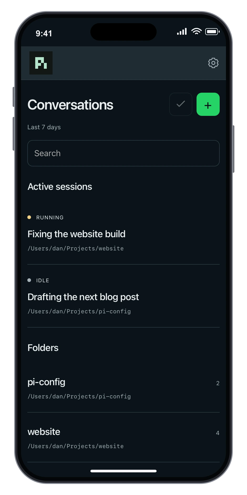
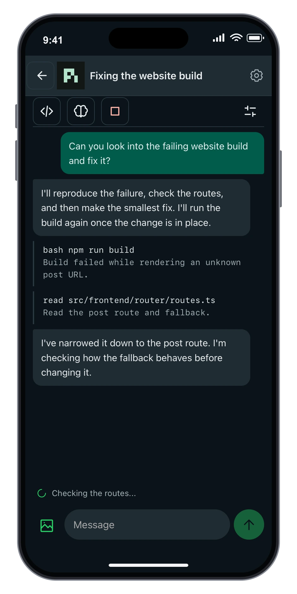
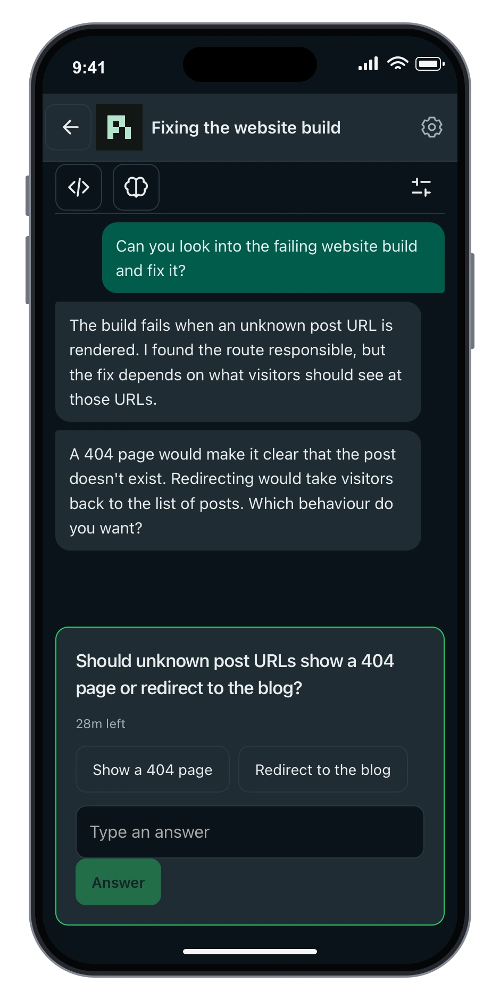
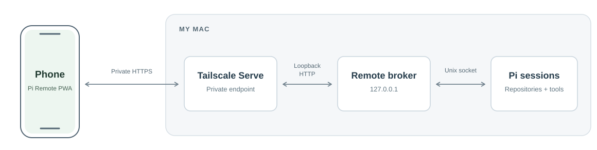

In my <router-link to="/posts/2026-06-02-agentic-coding-v3-pi">previous
post</router-link>, I covered how I'd built my coding workflow around
[Pi](https://pi.dev/) and its extension system. Just for a brief recap: Pi runs in my
terminal, integrates with Neovim, and uses custom tools and subagents to work on my
code. The appeal was being able to adapt the agent to how I work, rather than having to
adapt my workflow to whatever an existing coding assistant happened to support. Since
then, I've wanted to extend that same idea beyond the terminal itself.

The slightly awkward thing about getting an agent to work independently is that I still
had to sit near my laptop to interact with it. I could give Pi a task and leave it to
get on with things, but if it needed an answer, the conversation was still waiting in a
terminal window on my desk. And sometimes I just wanted to see how it was getting on, or
add something I'd forgotten in the original request, without opening the laptop and
settling back into work.

So I've built Pi Remote, a phone-friendly web app that connects to the Pi sessions
running on my Mac. It doesn't replace my usual setup; it gives me another way into the
same conversations. I can leave a task running, pick up my phone, and keep talking to
the agent without moving my code or tools anywhere. When I'm back at the keyboard, I can
carry on in the terminal where I left off. My laptop has apparently acquired a second
job as a server 🙃

This is the fourth post in my series about my agentic coding setup:

1. <router-link to="/posts/2026-01-18-local-ai-coding-assistant-in-nvim">Local AI Coding
   Assistant in Neovim in 2026</router-link>
2. <router-link to="/posts/2026-03-08-local-ai-coding-assistant-in-nvim-v2">Local AI
   Coding Assistant in Neovim in 2026 v2</router-link>
3. <router-link to="/posts/2026-06-02-agentic-coding-v3-pi">Local AI Coding Assistant in
   Neovim in 2026 v3</router-link>
4. Running Pi from my phone

### The phone is just the interface

I didn't want to recreate my development environment on a phone. My repositories are
already on the Mac, along with the tools, configuration, and running sessions that Pi
needs to do anything useful. Moving all of that somewhere else just so I could send a
message from a smaller screen felt like solving the wrong problem. Instead, the phone
talks to the agent that's already there. When I send a message, the Pi session on my
laptop receives it and continues working in its existing environment, with the context
it already has.

The app is a
[progressive web app](https://developer.mozilla.org/en-US/docs/Web/Progressive_web_apps),
or PWA, which means I can add it to my iPhone's home screen and open it like an app
without building and distributing a native iOS application. The phone isn't running the
coding agent, and it isn't running the model either. Where inference happens still
depends on how I've configured Pi: a local model can stay local, while a hosted provider
still receives the model requests. Remote changes how I interact with the session, not
which model it uses.

<figure class="diagram-figure remote-phone-figure">
  

    
    
    
  

  <figcaption>
    Pi Remote with example sessions: the overview, a conversation with tool activity,
    and a question waiting for my answer.
  </figcaption>
</figure>

### Picking up the conversation

There are already open-source Pi projects for this.
[Pi Pocket](https://github.com/TannerMidd/pi-pocket) offers a mobile-first web app built
on Pi Durable, but its documented limitations include not supporting Pi's own
extensions. That matters when so much of my setup lives in those extensions.
[PI WEB](https://github.com/jmfederico/pi-web) takes a remote-first approach, managing
Pi sessions in workspaces through its own runtime. My goal was to add phone access to
the sessions I already run in my terminal and Neovim, rather than move session
management into another application. That's the distinction that shaped this setup.

What I wanted on the phone was the conversation itself. I can open a session, read the
responses, and follow the tool activity while Pi works. If I have another instruction, I
can send it; if there's something visual to explain, I can attach an image or
screenshot. And when Pi asks me a question, I can answer it without going back to the
laptop.

Say I ask Pi to investigate a failing build before leaving my desk. It gets through the
initial investigation, but then finds that the fix depends on a decision about how a
feature should behave. That's a reasonable thing to ask me about, and I don't want to
disable questions altogether just because I'm away from the terminal. With Remote, I can
read what it found and answer from my phone. If its response reminds me of another case
it should check, I can add that too, rather than trying to remember it for when I'm
back.

It's still the same session, which is the useful bit. I'm not starting a second
conversation and explaining what the first agent was doing, and there's no separate copy
of the repository to reconcile afterwards. I can stop a run if it starts going in the
wrong direction, then return to my usual setup when I want to look properly at the
changes. I'm not planning to review a thousand-line diff on my phone, but answering a
question or asking for one more check is a much better fit.

### Getting from the phone to the Mac

Underneath the web app, there's a small broker running on the Mac. The Remote extension
connects Pi to that broker through a local Unix socket, and the broker provides the
connection to the phone interface. This keeps the networking out of the individual Pi
sessions: the extension passes session updates and interactions back and forth, rather
than each terminal session opening its own network listener. From the phone, I can
browse the sessions available through Remote and pick the conversation I want to
continue.

<figure class="diagram-figure">
  
  <figcaption>
    The phone is the interface. Tailscale Serve, the broker, and the Pi sessions all
    run on the Mac; the arrows carry messages and updates in both directions.
  </figcaption>
</figure>

For access away from the laptop, the broker sits behind private
[Tailscale Serve](https://tailscale.com/kb/1312/serve), using HTTPS. It listens on the
Mac's loopback interface, with Tailscale providing the path between my devices, rather
than exposing the app as a public website. Once that's configured, `pi-remote pair` on
the Mac produces a QR code and a short-lived, single-use pairing link. Opening that on
the phone pairs the browser with the broker, which issues a secure, HTTP-only cookie so
it can recognise the paired browser on later visits.

Pairing matters because this isn't just a way to read old chat messages; it's access to
an agent that can change files and run tools on my computer. Tailscale controls which
devices can reach the app, while the pairing cookie identifies a browser I've allowed to
use it. There's no separate passkey prompt when I open the app: a paired browser
reconnects using its cookie. If I need to remove that access, I can revoke the paired
device from the Mac.

One practical detail if I want to close the lid: the
<router-link to="/posts/2026-06-02-agentic-coding-v3-pi#caffeinate-keep-the-laptop-awake-but-not-too-awake">Caffeinate
extension from the previous post</router-link> keeps active work going with lid-close
protection configured. I sometimes put the laptop in a sleeve inside my bag while it's
still running, which is what prompted the temperature cutoff. At a battery temperature
of 35 °C (not CPU or room temperature), the extension disables lid-close protection and
explicitly requests macOS sleep if the lid is closed, retrying if the request fails. It
won't restore the keep-awake hold until I open the lid. Remote doesn't wake a sleeping
Mac, though. Once the Mac sleeps, I can't send another task from my phone until it's
awake again.

### Still my laptop, just a little less tied to the desk

What I like about this setup is that I haven't had to move my development environment
anywhere. Neovim and the terminal are still where I do the work that needs a proper
screen and keyboard, and the laptop still runs the agent and its tools. The phone just
covers the small interactions that used to require opening the laptop again. That's the
part I wanted: not to do all my coding on a phone, but to avoid treating every follow-up
message as a reason to return to my desk.

And that's it! The
[Remote app, broker, and CLI](https://github.com/saattrupdan/dotfiles/tree/main/agentic/pi/remote)
are in my dotfiles repo, along with the
[Remote session extension](https://github.com/saattrupdan/dotfiles/tree/main/agentic/pi/extensions/remote-control).
Like the rest of this setup, it's grown out of something I wanted to change about how I
work. In this case, my laptop was already doing the work; I just wanted to be able to
leave it alone without losing the conversation.

